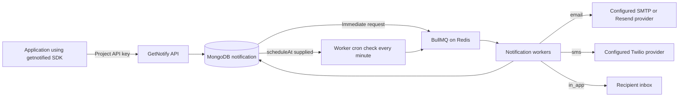

# GetNotify Notification Service API

GetNotify is a backend notification service for applications that need to send and track messages. It provides project API-key authentication, notification storage, background delivery, scheduling, and recipient inbox endpoints.

## Features

- Supports `in_app`, `email`, and `sms` notification delivery.
- Accepts `push` as a channel value, but push delivery is not implemented in the worker yet.
- Queues delivery through BullMQ and Redis, with retry handling for email and SMS jobs.
- Schedules notifications using a `node-cron` job that checks for due notifications every minute.
- Stores notification status and delivery results in MongoDB.
- Provides endpoints for organizations, projects, providers, API keys, notifications, and in-app inboxes.
- Includes a JavaScript/TypeScript SDK: [`getnotified` on npm](https://www.npmjs.com/package/getnotified).

## Notification flow



## Requirements

- Node.js
- MongoDB
- Redis
- An active delivery provider configured for each external channel you use. Email supports SMTP or Resend; SMS supports Twilio.

The server reads its runtime configuration from environment variables. At minimum, configure `MONGO_URI`, `REDIS_URL`, and `JWT_SECRET`; `PORT` defaults to `5000`. Provider credentials can be configured on the project provider or through the provider-specific environment variables used by the server. Keep credentials private and do not commit `.env` files.

## Run locally

Install the server dependencies and start the API:

```bash
npm install
npm run dev
```

Start the background worker in a separate process:

```bash
npm run worker
```

The worker connects to MongoDB and Redis, processes email, SMS, and in-app jobs, and starts the notification scheduler. Keep it running in deployment; the API process alone does not run the scheduler or deliver queued messages. For a production API process, use `npm start`.

## Use the SDK

Install the published SDK in the application that will call this API:

```bash
npm install getnotified
```

Initialize it with a project API key. The backend resolves the project from the key, so callers do not need to send a `projectId`:

```ts
import { getNotify } from "getnotified";

const notify = new getNotify({
  apiKey: process.env.GETNOTIFY_API_KEY!,
  // Optional; defaults to the hosted GetNotify API.
  baseUrl: "https://getnotify-y0ig.onrender.com",
});
```

### Send an SMS

SMS requests require a recipient phone number in `to`, a `recipientId`, and an active Twilio provider configured for the project:

```ts
const result = await notify.sendNotification({
  recipientId: "user_123",
  channel: "sms",
  to: "+15551234567",
  body: "Your verification code is 123456.",
});

if (result.status === "error") {
  console.error(result.error.message, result.error.code);
}
```

Email uses `channel: "email"` and requires `to`, `title`, and `body`. In-app notifications use `channel: "in_app"` and are available through the inbox endpoints.

### Schedule delivery

Pass a JavaScript date or ISO date-time string in `scheduleAt`. Supported scheduled channels are email, SMS, and in-app. The worker's cron job checks for due notifications every minute, so delivery can begin on the next check after the scheduled time:

```ts
await notify.sendNotification({
  recipientId: "user_123",
  channel: "sms",
  to: "+15551234567",
  body: "Your appointment is tomorrow.",
  scheduleAt: "2026-12-01T09:00:00.000Z",
});
```

The SDK also provides `notify.triggerEvent(payload)` for immediate event-triggered notifications. It calls `/api/v1/notifications/triggerEvent` and does not accept `scheduleAt`.

## API overview

Notification creation and event-trigger routes are protected by a project API key:

| Method | Endpoint | Purpose |
|---|---|---|
| `POST` | `/api/v1/notifications` | Create or schedule a notification |
| `POST` | `/api/v1/notifications/triggerEvent` | Create an immediate event notification |

The API also exposes organization, project, provider, API-key, and inbox routes under `/api/v1`. Notification creation responds with HTTP `202` and the stored notification. Common statuses include `scheduled`, `queued`, `processing`, `sent`, `delivered`, and `failed`.

## Delivery behavior and limitations

- Email and SMS jobs use BullMQ retries with exponential backoff. Failed jobs are sent to the dead-letter queue after retries are exhausted.
- The scheduler runs from the worker process, checks due scheduled notifications once per minute, and processes up to 100 due records per check.
- The scheduler uses an atomic status update before enqueueing a due notification to reduce duplicate queueing across worker instances.
- SMS delivery requires a project with an active Twilio provider and valid credentials.
- Although `push` is accepted by request validation, there is no push worker or scheduled push handler yet.
- The current inbox routes have server-side project-scoping and read-state limitations; consult the SDK documentation before relying on read/unread behavior.
