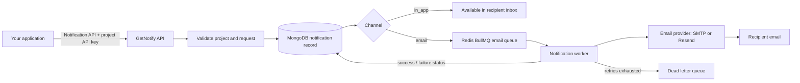

# GetNotify Notification Service API

GetNotify is a backend notification service API for applications that need to create and track notifications for their users. It provides project based API key access, notification storage, recipient inbox queries, and background email delivery.

## What it does

- Accepts notification requests from registered projects.
- Stores notification records with recipient, project, channel, content, and delivery status.
- Supports notification channels `in_app`, `email`, `sms`, in the request model.
- Processes email delivery asynchronously through a Redis backed queue and worker.
- Tracks delivery outcomes and sends exhausted email jobs to a dead letter queue.
- Provides APIs for user accounts, projects, providers, API keys, inboxes, and notification management.

> The current background worker handles email jobs. SMS and push delivery are not yet implemented in that worker.

## Notification flow



## Tech stack

- **Node.js and Express** for the REST API
- **MongoDB and Mongoose** for users, projects, and notification records
- **Redis, BullMQ, and ioredis** for background jobs and rate limiting
- **Nodemailer, Resend, and Twilio integrations** for provider connectivity
- **Zod** for request validation

## Running locally

Install dependencies and configure the environment variables required by the API, MongoDB, Redis, and your notification providers.

```bash
npm install
npm run dev
```

Run the email worker in a separate terminal:

```bash
npm run worker
```

For a standard start, use `npm start`.

## API overview

The notification router exposes project API key protected endpoints for creating notifications and triggering events. The service also includes endpoints for querying recipient notifications, fetching a notification, marking it as read, and deleting it. User and project routers provide the account and project setup needed to use the service.
