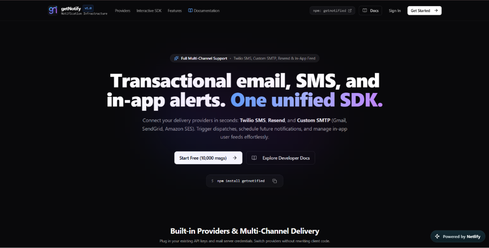
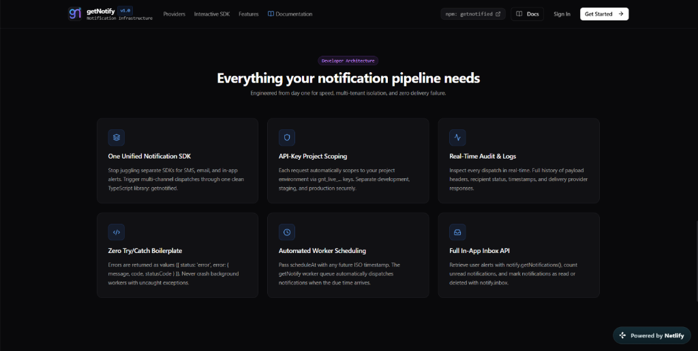
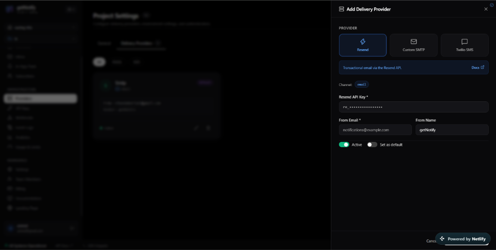
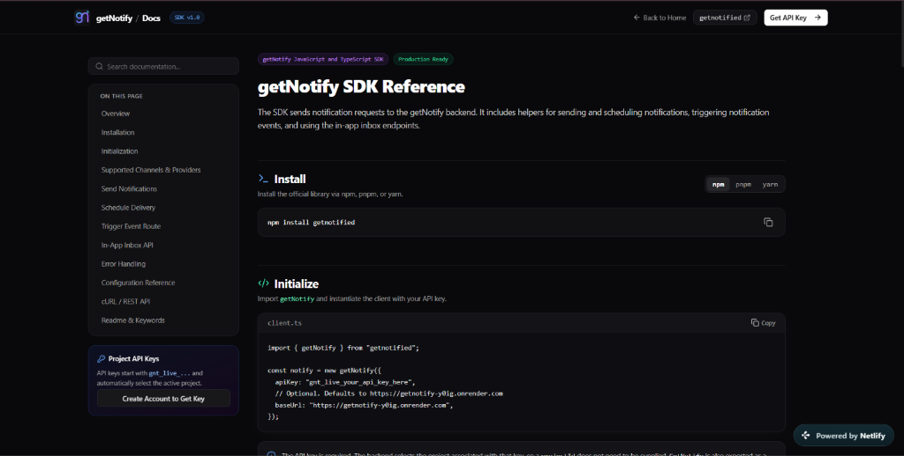
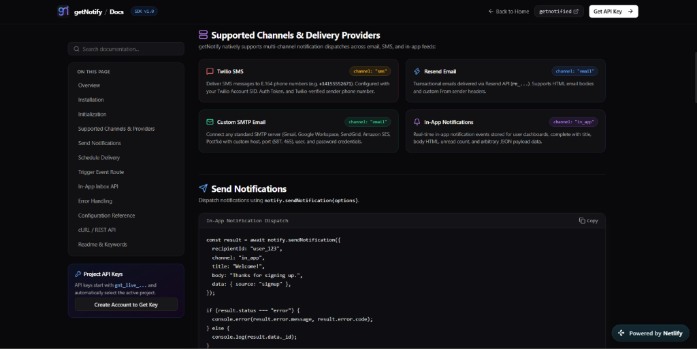

# getNotify – Notification Infrastructure API & Engine

[](https://www.npmjs.com/package/getnotified)
[](https://www.npmjs.com/package/getnotified)
[](https://opensource.org/licenses/MIT)
[](https://nodejs.org/)

**getNotify** is an open, multi-channel notification engine and transactional messaging backend for engineering teams. It unifies outbound delivery across **Twilio SMS**, **Resend**, **Custom SMTP** (Gmail, SendGrid, Amazon SES, Postfix), and **In-App recipient inboxes**, backed by Redis queueing, BullMQ workers, and automated cron scheduling.

---

## Quick Links

- 📦 **Official npm Package**: [`getnotified` on npm](https://www.npmjs.com/package/getnotified)
- 💻 **TypeScript / JavaScript SDK Repository**: [`client/`](../client/)
- 🌐 **Web Dashboard & Documentation Frontend**: [`frontend/`](../frontend/)
- 📖 **API Documentation**: Accessible at `/docs` (publicly available for all users)

---

## Product Screenshots & Platform Preview

### 1. Developer Landing Page
Modern developer landing page featuring multi-channel overview, instant install snippet, and live code previews.


### 2. Multi-Channel Architecture & Capabilities
Engineered for type-safety, API-key project scoping, real-time audit logs, and zero try/catch boilerplate.


### 3. Multi-Channel Provider Configuration Drawer
Configure **Resend**, **Custom SMTP**, or **Twilio SMS** with custom API keys, host/port, and sender settings.


### 4. Interactive Developer Documentation
Comprehensive public SDK reference covering installation, initialization, parameters, and error responses.


### 5. Multi-Channel Code Snippets & Dispatches
Pre-built code examples for Twilio SMS, Resend, SMTP, and In-App feeds directly in the documentation.


---

## Complete End-to-End Workflow

getNotify separates API request ingestion from delivery execution using message queues and scheduled background workers:

```mermaid
flowchart TD
    subgraph ClientLayer["1. Client & SDK Layer"]
        App["Your Application"]
        SDK["getnotified SDK (npm)"]
        App -->|"notify.sendNotification(payload)"| SDK
    end

    subgraph APILayer["2. API Gateway & Validation"]
        Gateway["getNotify Express API"]
        AuthCheck{"Validate x-api-key"}
        ProjLookup["Lookup Project & Providers"]
        DB[(MongoDB Database)]

        SDK -->|"HTTPS POST /api/v1/notifications"| Gateway
        Gateway --> AuthCheck
        AuthCheck -->|Valid gnt_live_...| ProjLookup
        ProjLookup -->|"Save notification (status: queued/scheduled)"| DB
    end

    subgraph QueueLayer["3. Queue & Scheduler Engine"]
        IsSched{"scheduleAt present?"}
        RedisQueue["BullMQ Queue (Redis)"]
        CronWorker["Cron Scheduler (Checks every 60s)"]

        ProjLookup --> IsSched
        IsSched -->|No: Immediate| RedisQueue
        IsSched -->|Yes: Future timestamp| CronWorker
        CronWorker -->|"When due: Atomic lock & enqueue"| RedisQueue
    end

    subgraph WorkerLayer["4. Notification Delivery Workers"]
        Worker["BullMQ Worker Process"]
        ChannelRouter{"Channel Router"}
        TwilioService["Twilio SMS Service"]
        ResendService["Resend API Service"]
        SMTPService["Nodemailer SMTP Service"]
        InAppService["In-App Feed Store"]

        RedisQueue --> Worker
        Worker --> ChannelRouter
        ChannelRouter -->|channel: 'sms'| TwilioService
        ChannelRouter -->|channel: 'email' (Resend)| ResendService
        ChannelRouter -->|channel: 'email' (SMTP)| SMTPService
        ChannelRouter -->|channel: 'in_app'| InAppService
    end

    subgraph DeliveryLayer["5. End-User Delivery & Auditing"]
        UserPhone["📱 User Phone (SMS)"]
        UserEmail["✉️ User Inbox (Email)"]
        UserDashboard["🔔 In-App Notification Feed"]

        TwilioService -->|"Outbound SMS"| UserPhone
        ResendService -->|"HTML Email"| UserEmail
        SMTPService -->|"SMTP Dispatch"| UserEmail
        InAppService -->|"Store alert"| UserDashboard

        TwilioService -.->|"Update delivery status"| DB
        ResendService -.->|"Update delivery status"| DB
        SMTPService -.->|"Update delivery status"| DB
        InAppService -.->|"Update delivery status"| DB
    end
```

### Workflow Steps Explained

1. **Trigger & Authentication**:
   - The application invokes the [`getnotified`](https://www.npmjs.com/package/getnotified) SDK with a project API key (`gnt_live_...`).
   - The API verifies the key, automatically resolving the associated organization, project, and active delivery providers.

2. **Persistence & Scheduling Check**:
   - The notification record is saved to MongoDB with recipient info, title, body HTML/text, metadata, and timestamp.
   - If `scheduleAt` is **omitted**: The message is enqueued immediately into Redis via BullMQ.
   - If `scheduleAt` is **provided**: The status is set to `scheduled`. The scheduler evaluates due notifications once every minute, applies an atomic update to prevent duplicate queueing across worker replicas, and enqueues them when their scheduled time arrives.

3. **Background Worker Execution**:
   - Dedicated worker processes consume jobs with automated retries and exponential backoff.
   - The worker dynamically inspects the project's configured provider:
     - **Twilio SMS**: Validates Account SID, Auth Token, and sender phone; dispatches via Twilio Programmable Messaging.
     - **Resend**: Delivers transactional HTML emails via the Resend API with custom `fromEmail` and `fromName`.
     - **Custom SMTP**: Authenticates with your SMTP server (Gmail, Postfix, SendGrid, Amazon SES) using custom host and port.
     - **In-App**: Stores the notification in the recipient's in-app feed for instant querying and unread count tracking.

4. **Audit Trail**:
   - Delivery outcomes (`sent`, `delivered`, `failed`), provider response IDs, and error diagnostics are persisted to MongoDB and displayed in the event audit logs.

---

## Supported Providers & Channels

| Channel | Provider | Configuration Requirements | Capabilities |
|---|---|---|---|
| `sms` | **Twilio SMS** | `accountSid`, `authToken`, `fromPhone` | Outbound SMS to E.164 phone numbers with carrier verification |
| `email` | **Resend** | `apiKey`, `fromEmail`, `fromName` | High-deliverability transactional HTML emails |
| `email` | **Custom SMTP** | `host`, `port`, `username`, `password`, `fromEmail` | Any SMTP server (Gmail, SendGrid, Amazon SES, private relay) |
| `in_app` | **In-App Inbox** | Native / Built-in | Real-time user feed, unread counter, and mark-as-read endpoints |
| `push` | **Push (Reserved)** | Accepted in payload validation | Payload specification ready for mobile push adapters |

---

## Installation & Running Locally

### Prerequisites

- **Node.js** (v18.0.0 or higher)
- **MongoDB** (running locally or MongoDB Atlas connection string)
- **Redis** (running locally on port 6379 or cloud Redis instance)

### 1. Environment Configuration

Copy `.env.example` to `.env` in the `server` directory:

```env
PORT=5000
MONGO_URI=mongodb://127.0.0.1:27017/getnotify
REDIS_URL=redis://127.0.0.1:6379
JWT_SECRET=your_jwt_secret_here
```

### 2. Start the API Server

```bash
cd server
npm install
npm run dev
```

### 3. Start the Background Worker & Scheduler

In a separate terminal process, run the worker:

```bash
cd server
npm run worker
```

> **Important**: The worker process manages BullMQ queues, handles retries, and runs the 1-minute `node-cron` scheduler. Both processes must run for full functionality.

---

## Using the Official SDK (`getnotified`)

Install the client library in your application:

```bash
# npm
npm install getnotified

# pnpm
pnpm add getnotified

# yarn
yarn add getnotified
```

### 1. Initialize the Client

```typescript
import { getNotify } from "getnotified";

const notify = new getNotify({
  apiKey: "gnt_live_your_api_key_here", // API key scopes to your project
  baseUrl: "https://getnotify-y0ig.onrender.com", // Optional hosted backend origin
});
```

### 2. Send SMS via Twilio

```typescript
const result = await notify.sendNotification({
  recipientId: "user_123",
  channel: "sms",
  to: "+14155552671",
  body: "Your verification code is 849-201. Valid for 10 minutes.",
});

if (result.status === "error") {
  console.error(result.error.message, result.error.code);
} else {
  console.log("SMS sent with ID:", result.data._id);
}
```

### 3. Send Email via Resend or Custom SMTP

```typescript
const result = await notify.sendNotification({
  recipientId: "user_123",
  channel: "email",
  to: "alex@example.com",
  title: "Your order receipt #9401",
  body: "<h1>Thanks for your purchase!</h1><p>Your items are on the way.</p>",
});
```

### 4. Schedule Future Delivery

```typescript
await notify.sendNotification({
  recipientId: "user_123",
  channel: "email",
  to: "user@example.com",
  title: "Subscription Renewal Reminder",
  body: "Your annual plan renews tomorrow.",
  scheduleAt: "2026-12-01T09:00:00.000Z", // Evaluated by the worker scheduler
});
```

### 5. In-App User Inbox & Unread Counts

```typescript
// Query user's inbox
const inbox = await notify.getNotifications("user_123");

// Get total unread count
const unread = await notify.getUnreadCount("user_123");
console.log("Unread count:", unread.data);

// Mark notification as read
if (inbox.data && inbox.data[0]) {
  await notify.markAsRead(inbox.data[0]._id);
}
```

---

## REST API Endpoints Overview

| Method | Endpoint | Authentication | Description |
|---|---|---|---|
| `POST` | `/api/v1/notifications` | `x-api-key` | Create an immediate or scheduled notification |
| `POST` | `/api/v1/notifications/triggerEvent` | `x-api-key` | Trigger an immediate event notification |
| `GET` | `/api/v1/inbox/:recipientId` | Bearer Token / Open | Fetch in-app notifications for recipient |
| `GET` | `/api/v1/inbox/:recipientId/unread-count` | Bearer Token / Open | Get unread notification count |
| `PATCH` | `/api/v1/inbox/:id/read` | Bearer Token / Open | Mark notification as read |
| `POST` | `/api/v1/auth/register` | Public | Register developer user account |
| `POST` | `/api/v1/auth/login` | Public | Authenticate user & obtain JWT |
| `GET/POST` | `/api/v1/projects` | Bearer Token | Manage workspace project environments |
| `GET/POST` | `/api/v1/providers` | Bearer Token | Connect Resend, SMTP, or Twilio providers |
| `GET/POST` | `/api/v1/api-keys` | Bearer Token | Generate and revoke project API keys |

---

## Reliability & Fault Tolerance

- **Exponential Backoff**: BullMQ retries failed email and SMS jobs up to 3 times with exponential backoff before sending to the dead-letter queue.
- **Atomic Scheduler Lock**: Uses atomic MongoDB status transitions (`status: "scheduled"` $\to$ `status: "queued"`) before queue insertion to guarantee zero duplicate dispatch across multi-replica worker deployments.
- **Consistent Error Objects**: The SDK returns errors as values (`result.status === "error"`), eliminating uncaught exceptions in serverless and worker runtimes.

---

## License

This project is licensed under the [MIT License](LICENSE).
